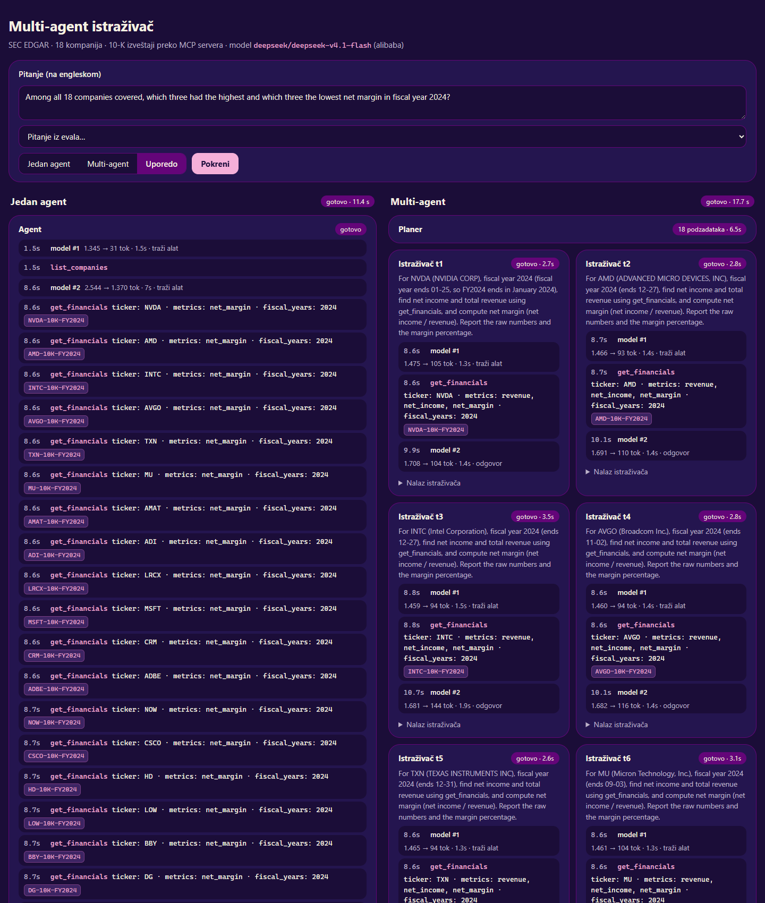
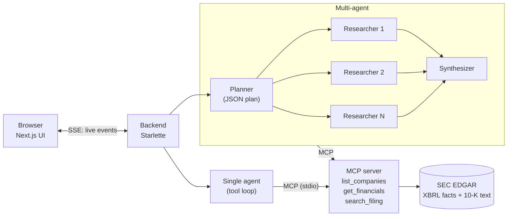
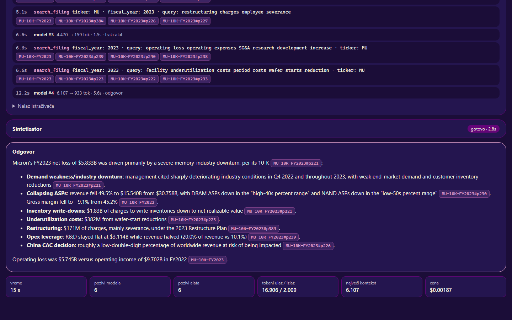
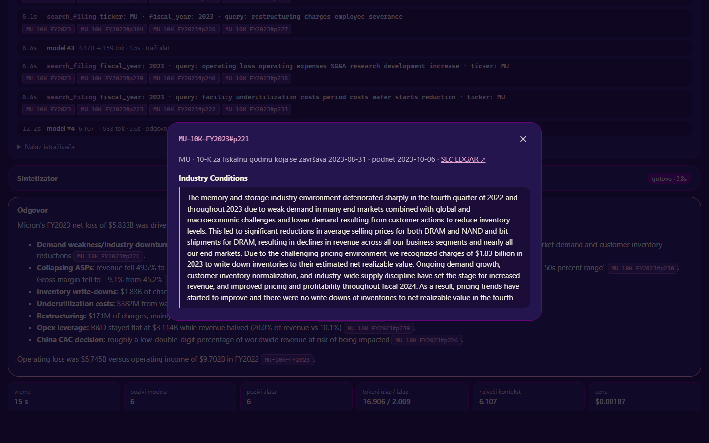

# SEC EDGAR Multi-Agent Researcher

An MCP server over SEC filings of 18 US companies, two hand-written agent architectures on top of it
(a single agent and a planner → parallel researchers → synthesizer team), a live UI that shows the agents
at work, and an evaluation that measures when the multi-agent design is actually worth it.

**Python · MCP (Model Context Protocol) · OpenRouter (DeepSeek V4.1 Flash, Gemma 4 26B) · Starlette + SSE · Next.js**



*Left: the single agent fetches all 18 companies in one step. Right: the planner splits the question into
18 subtasks and the researchers run in parallel. Every model call and tool call streams to the browser live.*

## Key results

16 questions × 2 systems × 3 runs, for each of two models. Same tools and prompt rules for both systems,
thinking off, temperature 0. Answers graded blind; citations validated automatically.

| | DeepSeek V4.1 Flash<br>single / multi | Gemma 4 26B A4B<br>single / multi |
|---|---|---|
| Accuracy, 12 core questions | 100% / 100% | 95.8% / 91.7% |
| Accuracy, 4 hard questions | 91.7% / 91.7% | **70.8% / 91.7%** |
| Cost per correct answer | **$0.0007** / $0.0020 | **$0.0008** / $0.0012 |
| Time per question | **5.8 s** / 11.1 s | **6.5 s** / 11.1 s |
| Largest single prompt | **6.9k** / 9.5k tokens | 7.8k / **4.5k** tokens |
| Valid citations | 99.5% / 97.5% | 99.5% / 98.7% |

What we found:

1. **With a strong model, the multi-agent system is not worth it here.** Same accuracy, ~3× the cost,
   ~2× the latency. Parallel researchers do speed up the research phase (~2×), but the extra planner and
   synthesizer calls cost more than parallelism saves.
2. **With a weaker model, it pays off on broad tasks** (+21 points on the hard questions). Asked about all
   18 companies, Gemma as a single agent calls one tool per step and runs out of its 10-step budget (0/3);
   each researcher handles one company and finishes (3/3).
3. **"Researchers keep contexts short" held only for the weaker model.** With DeepSeek the largest prompt
   was in the multi-agent system, because the synthesizer receives every researcher's findings.
4. **Known architecture risk:** the planner commits to a plan before seeing any data. On a question like
   *"compare the top 3 companies in every group"* it picked the first three companies of each sector,
   missed Micron and answered wrongly, at 9× the single agent's cost (details below).

Full reports: [`eval/results/2026-11-08_1903/report.md`](eval/results/2026-11-08_1903/report.md) (DeepSeek),
[`eval/results/2026-11-08_1949/report.md`](eval/results/2026-11-08_1949/report.md) (Gemma).

## Architecture



All agents call the model through one OpenAI-compatible client (OpenRouter, provider pinned) and share
**one** MCP connection. The researchers are the same loop as the single agent, with their own prompt.

## How it works

**MCP server** (`mcp_server/`). Three tools over SEC EDGAR data for 18 companies (semiconductors, software,
retail), fiscal years 2022+:
- `get_financials`: annual revenue, gross/operating/net income, R&D, plus margins and growth computed by
  the server. The messy parts of XBRL are handled here, not left to the model: duplicate periods across
  filings (keep the original 10-K), the same metric under several tags (fixed priority, never min/max),
  and fiscal years that companies name differently (fiscal year = calendar year in which it *ends*).
- `search_filing`: hand-written BM25 over 10-K passages (150-word overlapping windows, section names from
  headings, risk-factor boilerplate down-weighted).
- Every number carries a `source_id` (`INTC-10K-FY2024`) and every passage a `passage_id`
  (`MU-10K-FY2023#p221`), so answers can be cited and checked.

**Agent loop** (`agents/single_agent.py`, no framework). A list of messages and a `for` loop: send messages
and tool schemas to the model; if it asks for tools, run them over MCP and append the results; otherwise
stop. Tool errors go back to the model as text so it can fix its arguments. A response cut at the token
limit is not counted as an answer. Provider-specific options are built in one place (`provider_options`).

**Multi-agent** (`agents/multi_agent.py`). The planner gets the list of companies (no tools) and returns a
JSON plan, with one retry and a single-researcher fallback. Researchers run with `asyncio.gather`, at most 6
at a time, and one failing researcher does not stop the others. The synthesizer writes the answer only from
the findings and must say which data is missing.

**Evaluation** (`eval/`).
- Questions and verified answers were written **before** running any system. Four harder questions
  (breadth, multi-company explanations, multi-hop, a fiscal-year naming trap) were added and verified
  before their first run.
- `run_eval.py` runs both systems in alternating order and stores a full trace of every answer.
- Answers are shuffled and anonymised (`to_grade.json`). Grades (1 / 0.5 / 0, with a reason, by the rules
  stored with each question) are written before the system key is opened. The team spot-checked a sample.
- A citation counts as valid only if that ID was returned by a tool **in the same run**.

**UI** (`web/`). The backend runs an agent as a task and forwards every `on_event` callback to the browser
over Server-Sent Events; closing the page cancels the agent. The frontend turns the event stream into screen
state with a reducer. Citations are buttons: green if a tool returned that source in this run, red if not.
Clicking one shows the exact 10-K passage.




## Run it

Windows / PowerShell, Python 3.11+, Node 20+.

```powershell
git clone https://github.com/StefanJ2004/MCP-server-multiagent-reasoning-solution.git
cd MCP-server-multiagent-reasoning-solution
python -m venv .venv; .venv\Scripts\activate
pip install -e ".[dev]"
copy .env.example .env            # set OPENAI_API_KEY (OpenRouter) and SEC_USER_AGENT ("Name email")
python scripts/download_data.py   # ~100 MB of SEC data, a few minutes
pytest -q                         # 102 tests; agents are tested with a fake model, tools and data are real
```

**Ask a question from the command line**

```powershell
python -m agents.single_agent --id F1
python -m agents.multi_agent "Why did Micron report a loss in FY2023, according to its 10-K?"
```

**Live UI** (two terminals)

```powershell
python -m web.server                   # backend on http://localhost:8000
cd web/ui; npm install; npm run dev    # frontend on http://localhost:3000
```

**Evaluation**

```powershell
python eval/run_eval.py                       # 16 questions x 2 systems x 3 runs -> eval/results/<timestamp>/
python eval/report.py eval/results/<folder>   # report.md (accuracy needs grades.json)
```

Another model without touching `.env`: `$env:MODEL="google/gemma-4-26b-a4b-it"; $env:OPENROUTER_PROVIDER="deepinfra"`.

**Use the MCP server directly**: `npx @modelcontextprotocol/inspector .venv\Scripts\python.exe -m mcp_server.server`,
or add it to Claude Desktop (`%APPDATA%\Claude\claude_desktop_config.json`):

```json
{ "mcpServers": { "sec-edgar": { "command": "<path>\\.venv\\Scripts\\python.exe", "args": ["-m", "mcp_server.server"] } } }
```

## Limitations and risks

- **The planner decides before it sees data.** On *"compare the top 3 companies form every groupation and
  tell me which one is the most profitable"* (asked outside the eval, DeepSeek), the planner took the first
  three companies listed per sector, missed Micron (63.8% net margin, the highest) and answered "NVIDIA",
  using 36 model calls and $0.0147. The single agent looked at all 18 companies and answered correctly
  (Micron by margin, Microsoft by absolute profit) with 3 model calls and $0.0016. A two-step planner that
  ranks with `get_financials` first would address this; it is not implemented. The question was deliberately
  **not** added to the eval, because it was chosen after seeing the result.
- **Small, easy-for-strong-models eval.** 16 questions, 3 runs each; the strong model is near the ceiling.
- **Grading.** Done blind by Claude (the same assistant that helped build the system) and spot-checked by
  the team. Blindness was imperfect: multi-agent answers sometimes mention "researchers", and the second
  eval reused the first eval's shuffle seed (fixed since).
- **The 10-step limit matters.** Gemma's single-agent failure on the breadth question depends on it.
- **Provider effects.** Gemma on Google Vertex merged parallel tool calls into one invalid call, so the Gemma
  eval uses DeepInfra (fp8 quantized). The loop now strips invalid arguments from the history.

## What we learned

- Tool design and data cleaning decide most of the quality: clear tool descriptions, enums for arguments,
  and server-side handling of XBRL quirks did more than prompt tweaks.
- One run proves nothing. The single agent got the C4 conclusion wrong once in a quick test and right
  3/3 times in the eval.
- Multi-agent is not free. It helped exactly where a single context and a step budget became the bottleneck
  (a weaker model, a broad task), and cost more everywhere else.
- Providers differ: the same open model can call tools correctly on one host and break them on another.

## Project structure

```
mcp_server/   MCP server: data cleaning (financials.py), BM25 search (search.py), tools (server.py)
agents/       single_agent.py (tool loop), multi_agent.py (planner, researchers, synthesizer)
eval/         questions.json, run_eval.py, report.py, metrics.py, results/
web/          server.py (Starlette, SSE) and ui/ (Next.js)
scripts/      download_data.py, benchmark_ollama.py (why a local 4B model was dropped)
tests/        102 tests
docs/         screenshots, demo video script
```

Built by a team of four students in ~30 hours, with Claude Code as a pair programmer. Planning notes,
decisions and the full status log are in Serbian: [`hakaton.md`](hakaton.md), [`handoff.md`](handoff.md).
